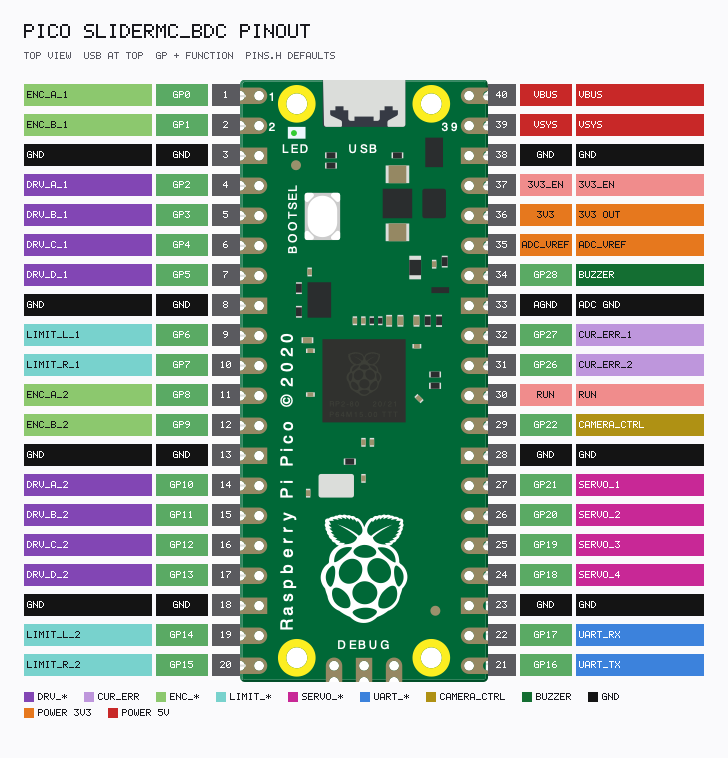
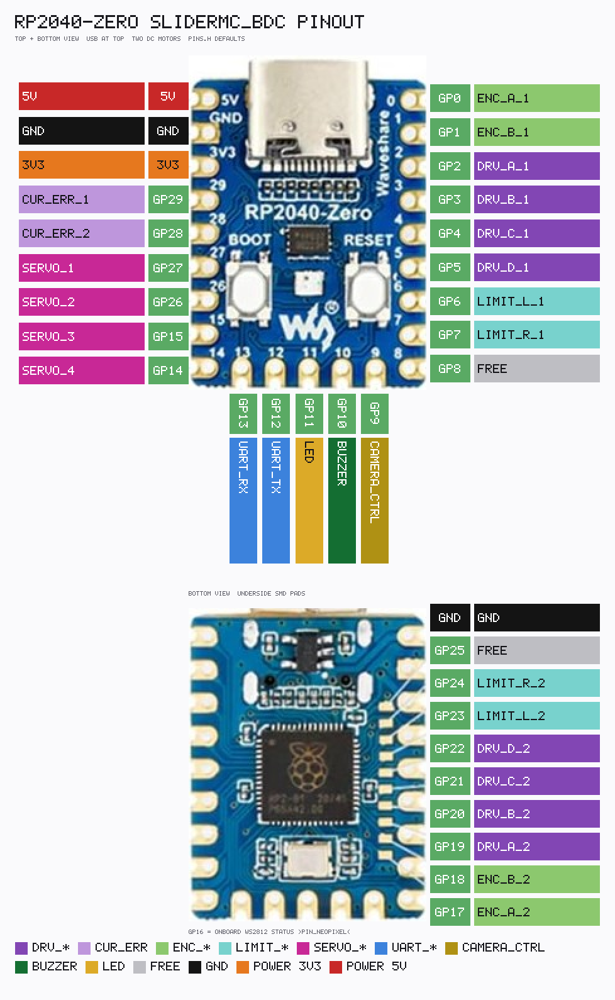

<link rel="stylesheet" type="text/css" href="../tools/SliderCtrl.css">
<style>
:root {
  --doc-title: "SliderMC_BDC pin map";
  --doc-path: ".\\SliderDoc\\mc-bdc\\pins.md";
}
</style>

# Pin map

Pins are fixed in SliderMC_BDC `include/pins.h`. `CS motors` is 1–2. `CS servos` is 0–4. Servo 1 uses the same GPIO as `EXT_4`, servo 2 as `EXT_3`, servo 3 as `EXT_2`, and servo 4 as `EXT_1`. With no servo configured, all four extender pins are free.

`VG` prints `PIN_*=GPIO`. `IG` prints the name table. Motor-2 rows appear only when `CS motors 2`. Servo rows appear when that servo is configured.

Pico 2 uses this Pico header map. RP2350-Zero uses the RP2040-Zero map.

On the Pico, a motor PWM pin and the servo 16 GPIO numbers higher are the same PWM channel: `DRV_A_1` with `SERVO_4`, `DRV_B_1` with `SERVO_3`, `DRV_C_1` with `SERVO_2`, `DRV_D_1` with `SERVO_1`. The firmware does not run a servo on a slice the motor driver is using for PWM. An `EXT` pin used as a plain GPIO is fine.

---

## Raspberry Pi Pico (`BOARD_PICO`, env `pico`) / Pico 2 (`pico2`)



Regenerate: `python tools/render_pico_pinout_SliderMC_BDC.py` → [`MCBDC_Pico_pinout.txt`](../assets/MCBDC_Pico_pinout.txt) + PNG.

```text
                    USB
        GP0  ENC_A1     VBUS
        GP1  ENC_B1     VSYS
        GND             GND
        GP2  DRV_A1     3V3
        GP3  DRV_B1     GP28 BUZZER
        GP4  DRV_C1     GND
        GP5  DRV_D1     GP27 CUR/ERR1
        GND             GP26 CUR/ERR2
        GP6  LIMIT_L1   RUN
        GP7  LIMIT_R1   GP22 CAM
        GP8  ENC_A2     GND
        GP9  ENC_B2     GP21 SERVO1 / EXT4
        GND             GP20 SERVO2 / EXT3
        GP10 DRV_A2     GP19 SERVO3 / EXT2
        GP11 DRV_B2     GP18 SERVO4 / EXT1
        GP12 DRV_C2     GND
        GP13 DRV_D2     GP17 UART RX
        GND             GP16 UART TX
        GP14 LIMIT_L2   GP15 LIMIT_R2
```

| Symbol | GPIO | Role |
|--------|------|------|
| `PIN_ENC_A_1` / `PIN_ENC_B_1` | 0 / 1 | Motor 1 quadrature. B is A+1 |
| `PIN_DRV_A_1` .. `PIN_DRV_D_1` | 2 .. 5 | Motor 1 generic outputs |
| `PIN_SW_LIMIT_L_1` / `PIN_SW_LIMIT_R_1` | 6 / 7 | Motor 1 hard limits (off until `*_use` is 1) |
| `PIN_ENC_A_2` / `PIN_ENC_B_2` | 8 / 9 | Motor 2 quadrature |
| `PIN_DRV_A_2` .. `PIN_DRV_D_2` | 10 .. 13 | Motor 2 generic outputs |
| `PIN_SW_LIMIT_L_2` / `PIN_SW_LIMIT_R_2` | 14 / 15 | Motor 2 hard limits |
| `PIN_UART_TX` / `PIN_UART_RX` | 16 / 17 | UART to the UIC, 115200 baud, `Serial1` |
| `PIN_SERVO_4` / `PIN_EXT_1` | 18 | Servo 4, or extender `EO1` when servos &lt; 4 |
| `PIN_SERVO_3` / `PIN_EXT_2` | 19 | Servo 3, or `EO2` when servos &lt; 3 |
| `PIN_SERVO_2` / `PIN_EXT_3` | 20 | Servo 2, or `EO3` when servos &lt; 2 |
| `PIN_SERVO_1` / `PIN_EXT_4` | 21 | Servo 1, or `EO4` when servos = 0 |
| `PIN_CAMERA_CTRL` | 22 | Camera open-collector, low-active |
| `PIN_LED` | 25 | Onboard LED (not on the 40-pin header) |
| `PIN_DRV_CUR_ERR_2` | 26 | Motor 2 current or fault |
| `PIN_DRV_CUR_ERR_1` | 27 | Motor 1 current or fault |
| `PIN_BUZZER` | 28 | Piezo, gated by `BUZZER_use` |

---

## Waveshare RP2040-Zero (`BOARD_RP2040_ZERO`, env `rp2040zero`) / RP2350-Zero



Regenerate: `python tools/render_rp2040zero_pinout_SliderMC_BDC.py` → [`MCBDC_RP2040zero_pinout.txt`](../assets/MCBDC_RP2040zero_pinout.txt) + PNG.

Motor 1 uses GP0–GP7, the same signals as the Pico. A stock Waveshare header only brings out GP0–GP15 and GP26–GP29. GP16 is the onboard NeoPixel. Motor 2, and the LED on GP11, need the other GPIOs on a carrier.

```text
        GP0  ENC_A1       GP15 SERVO3 / EXT2
        GP1  ENC_B1       GP14 SERVO4 / EXT1
        GP2  DRV_A1       GP13 UART RX
        GP3  DRV_B1       GP12 UART TX
        GP4  DRV_C1       GP11 LED
        GP5  DRV_D1       GP10 BUZZER
        GP6  LIMIT_L1     GP9  CAM
        GP7  LIMIT_R1     GP8  free

        GP16 NeoPixel (onboard)
        GP17 ENC_A2   GP18 ENC_B2
        GP19 DRV_A2   GP20 DRV_B2   GP21 DRV_C2   GP22 DRV_D2
        GP23 LIMIT_L2  GP24 LIMIT_R2
        GP25 free
        GP26 SERVO2 / EXT3    GP27 SERVO1 / EXT4
        GP28 CUR/ERR2         GP29 CUR/ERR1
```

| Symbol | GPIO | Role |
|--------|------|------|
| `PIN_ENC_A_1` / `PIN_ENC_B_1` | 0 / 1 | Motor 1 quadrature |
| `PIN_DRV_A_1` .. `PIN_DRV_D_1` | 2 .. 5 | Motor 1 generic outputs |
| `PIN_SW_LIMIT_L_1` / `PIN_SW_LIMIT_R_1` | 6 / 7 | Motor 1 hard limits |
| `PIN_CAMERA_CTRL` | 9 | Camera open-collector |
| `PIN_BUZZER` | 10 | Piezo |
| `PIN_LED` | 11 | Status LED |
| `PIN_UART_TX` / `PIN_UART_RX` | 12 / 13 | UART, 115200 baud |
| `PIN_SERVO_4` / `PIN_EXT_1` | 14 | Servo 4 or `EO1` |
| `PIN_SERVO_3` / `PIN_EXT_2` | 15 | Servo 3 or `EO2` |
| `PIN_NEOPIXEL` | 16 | Onboard WS2812 |
| `PIN_ENC_A_2` / `PIN_ENC_B_2` | 17 / 18 | Motor 2 quadrature |
| `PIN_DRV_A_2` .. `PIN_DRV_D_2` | 19 .. 22 | Motor 2 generic outputs |
| `PIN_SW_LIMIT_L_2` / `PIN_SW_LIMIT_R_2` | 23 / 24 | Motor 2 hard limits |
| `PIN_SERVO_2` / `PIN_EXT_3` | 26 | Servo 2 or `EO3` |
| `PIN_SERVO_1` / `PIN_EXT_4` | 27 | Servo 1 or `EO4` |
| `PIN_DRV_CUR_ERR_2` | 28 | Motor 2 current or fault |
| `PIN_DRV_CUR_ERR_1` | 29 | Motor 1 current or fault |

GP8 and GP25 are free.

## Shared notes

Encoder B must be the next GPIO after A. Limit inputs stay off until `motor_N_limit_*_use` is 1. `DRV_CUR_ERR_n` is an ADC current input or a digital fault, chosen by `motor_N_sense`, never both. There is no shared driver-enable pin; enable is one of `DRV_A`..`DRV_D` according to the [driver preset](drivers.md).
